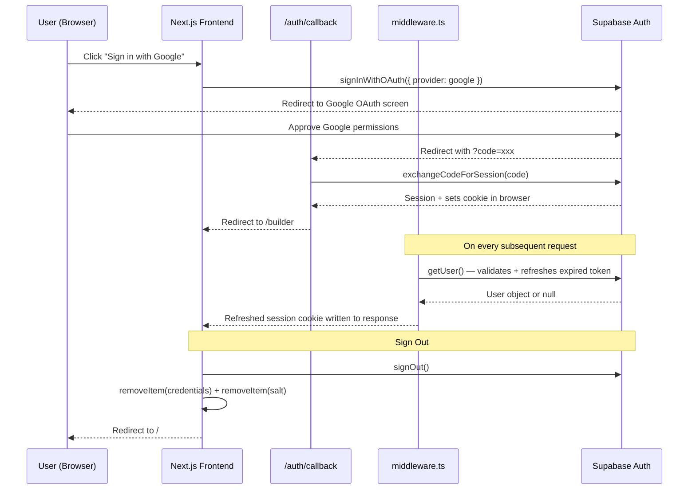
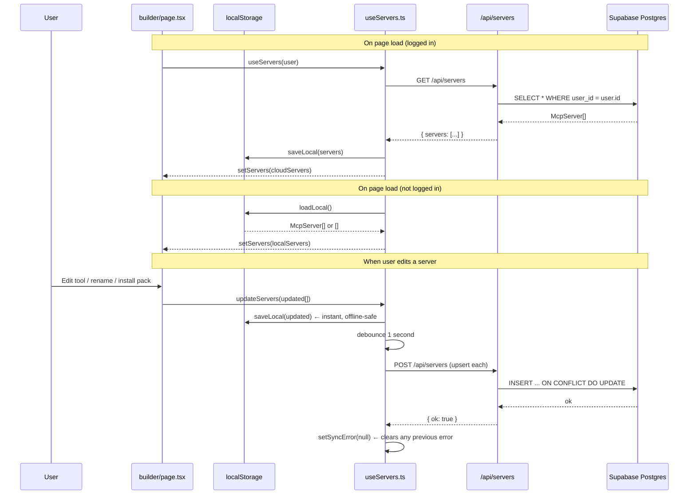
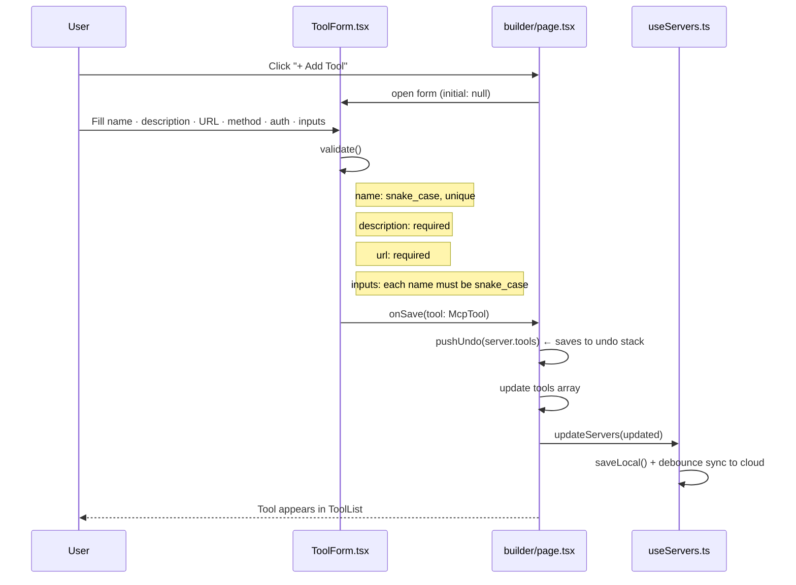
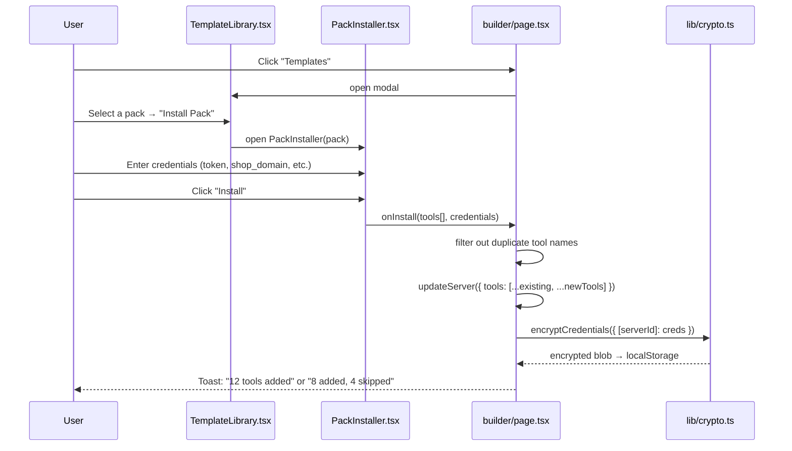
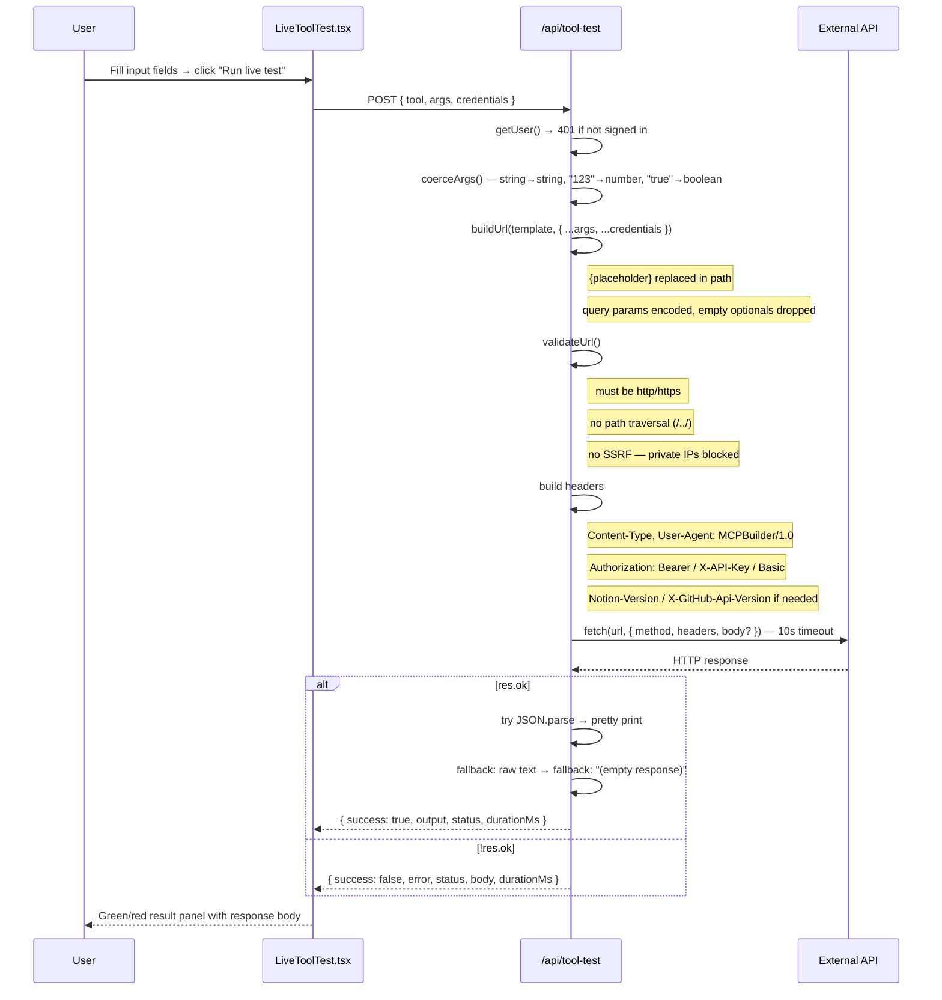
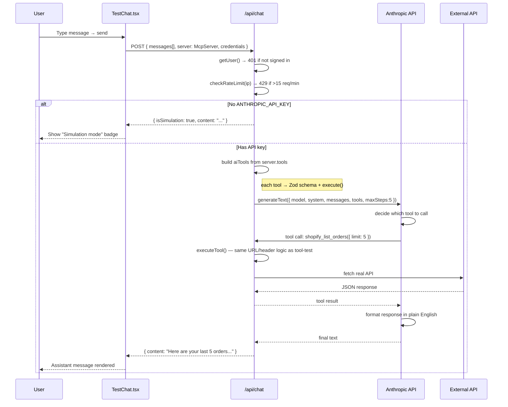

# Data Flow — MCP Visual Builder

Nabeel Shaikh · MCP Visual Builder

---

## 1. System Overview

```
┌─────────────────────────────────────────────────────────────┐
│                        BROWSER                              │
│  Next.js 15 · TypeScript · Tailwind CSS · Supabase Auth    │
└──────────────────────┬──────────────────────────────────────┘
                       │  HTTPS  (Supabase session cookie)
                       ▼
┌─────────────────────────────────────────────────────────────┐
│                   NEXT.JS API SERVER                        │
│  /api/servers   /api/servers/[id]                           │
│  /api/chat      /api/tool-test                              │
└──────┬────────────────────────────────┬─────────────────────┘
       │                                │
       ▼                                ▼
┌──────────────────┐          ┌─────────────────────────────┐
│  Supabase        │          │  External REST APIs          │
│  Postgres DB     │          │  (Shopify · GitHub · Stripe  │
│                  │          │   Notion · Airtable · etc.)  │
│  mcp_servers     │          └──────────────�┬──────────────┘
│  (JSONB tools)   │                         │
└──────────────────┘          ┌──────────────▼──────────────┐
                              │  Anthropic API               │
                              │  claude-haiku-4-5            │
                              └─────────────────────────────┘
```

---

## 2. Authentication Flow



---

## 3. Server State & Cloud Sync Flow



---

## 4. Credential Encryption Flow

Credentials (API tokens, shop domains) are **never stored in the database**. They live only in the browser, encrypted.

```
User enters API token in PackInstaller
              │
              ▼
builder/page.tsx: setAllCredentials({ [serverId]: { token: '...' } })
              │
              ▼ (useEffect triggers)
lib/crypto.ts: encryptCredentials(allCredentials)
  ┌─────────────────────────────────────────────────────────┐
  │  getOrCreateKey()                                       │
  │  ├─ read localStorage['mcp-builder-salt']               │
  │  ├─ if missing: generate 32 random bytes, store base64  │
  │  └─ crypto.subtle.importKey(bytes, 'AES-GCM', 256)      │
  ├─────────────────────────────────────────────────────────┤
  │  generate random 12-byte IV                             │
  │  crypto.subtle.encrypt({ AES-GCM, iv }, key, JSON)      │
  │  store → base64(IV + ciphertext) in localStorage        │
  └─────────────────────────────────────────────────────────┘
              │
              ▼
        localStorage['mcp-builder-credentials-v2'] = encrypted blob

On load → decryptCredentials(blob)
  ├─ getOrCreateKey()  (same salt → same key)
  ├─ slice bytes 0–12  → IV
  ├─ slice bytes 12+   → ciphertext
  └─ crypto.subtle.decrypt() → JSON.parse() → credentials object
```

---

## 5. Tool Creation Flow



---

## 6. Pack Installation Flow



---

## 7. Live Tool Test Flow



---

## 8. AI Chat Flow



---

## 9. Code Generation Flow

Code generation runs **entirely client-side** — no server involved.

```
User opens Export tab → ExportPanel.tsx
              │
              ▼
lib/codegen.ts (runs in browser)
  ┌──────────────────────────────────────────────────────────┐
  │  generateServerCode(server, credentials)                 │
  │  ├─ for each McpTool:                                    │
  │  │    genZodSchema(inputs)                               │
  │  │    → z.object({ city: z.string().describe("...") })  │
  │  │    genFetchCall(tool, credentials)                    │
  │  │    ├─ bake config values into URL (shop_domain etc.)  │
  │  │    │   using split/join — not RegExp (avoids inject.) │
  │  │    ├─ convert {placeholders} → ${args.x} literals     │
  │  │    └─ build fetch() with headers + 10s timeout        │
  │  └─ → complete server.js as a string                     │
  ├──────────────────────────────────────────────────────────┤
  │  generateClaudeConfig()   → claude_desktop_config.json  │
  │  generateServerPackageJson() → package.json             │
  │  generateInstallScriptUnix()  → install.sh (bash)       │
  │  generateInstallScriptWindows() → install.ps1 (PS)      │
  └──────────────────────────────────────────────────────────┘
              │
              ▼
ExportPanel renders each file in a <pre> block
  ├─ Copy button → clipboard
  ├─ Download button → Blob download
  └─ "Download All" → downloads server.js + config + package.json
```

---

## 10. Undo / Redo Flow

```
builder/page.tsx maintains two stacks (max 50 steps each):
  undoStack: McpTool[][]
  redoStack: McpTool[][]

  pushUndo(currentTools)             undo()
  ├─ append snapshot to undoStack    ├─ pop from undoStack → tools
  └─ clear redoStack                 ├─ push server.tools → redoStack
                                     └─ updateServer({ tools })

  redo()
  ├─ pop from redoStack → tools
  ├─ push server.tools → undoStack
  └─ updateServer({ tools })

  Keyboard shortcuts (window event listener):
  Ctrl + Z          → undo()
  Ctrl + Shift + Z  → redo()
  ?                 → toggle shortcuts help (ignored inside inputs)
  Escape            → close modals
```

---

## 11. Database Schema

```
mcp_servers
├── id           TEXT          PRIMARY KEY
├── user_id      TEXT NOT NULL ← indexed (mcp_servers_user_id_idx)
├── name         TEXT NOT NULL
├── description  TEXT NOT NULL DEFAULT ''
├── tools        JSONB NOT NULL DEFAULT '[]'
├── created_at   TIMESTAMP NOT NULL DEFAULT now()
└── updated_at   TIMESTAMP NOT NULL DEFAULT now()

Note: credentials are intentionally NOT stored in the database.
      They live only in the browser, AES-GCM encrypted in localStorage.
```

---

## 12. API Endpoints

| Method | Endpoint | Auth | Rate Limit | Description |
|--------|----------|------|------------|-------------|
| GET | `/api/servers` | Required | — | List all servers for the logged-in user |
| POST | `/api/servers` | Required | 60/min per user | Upsert a server definition |
| DELETE | `/api/servers/{id}` | Required | — | Delete a server (checks ownership) |
| POST | `/api/chat` | Required | 15/min per IP | AI Chat — proxies to Anthropic + executes tools |
| POST | `/api/tool-test` | Required | — | Live test — proxies one tool call to real API |

---

## 13. End-to-End Example: "Show me my last 5 orders"

```
1. User types "Show me my last 5 orders" in AI Chat tab
   TestChat.tsx → POST /api/chat
   { messages: [{role:"user", content:"Show me my last 5 orders"}],
     server: { tools: [shopify_list_orders, ...] },
     credentials: { token: "shpat_xxx", shop_domain: "mystore.myshopify.com" } }

2. /api/chat validates session → passes rate limit → builds tool objects
   shopify_list_orders = CoreTool {
     description: "List recent orders...",
     parameters: z.object({ status: z.enum([...]).optional(), limit: z.number().optional() }),
     execute: async ({ limit }) => executeTool(tool, { limit }, credentials)
   }

3. generateText() calls Anthropic claude-haiku-4-5
   Claude decides → call shopify_list_orders({ limit: 5 })

4. executeTool() fires:
   URL  → https://mystore.myshopify.com/admin/api/2025-01/orders.json?limit=5
   Headers → X-Shopify-Access-Token: shpat_xxx
             Content-Type: application/json
             User-Agent: MCPBuilder/1.0

5. Shopify responds → { orders: [{ id, name, total_price, ... }, ...] }

6. Tool result returned to Claude
   Claude formats: "Here are your last 5 orders:
                   1. #1234 — $149.99 — Fulfilled
                   2. #1233 — $89.00 — Pending..."

7. /api/chat returns { content: "Here are your last 5 orders:..." }
   TestChat.tsx renders as assistant message
```
